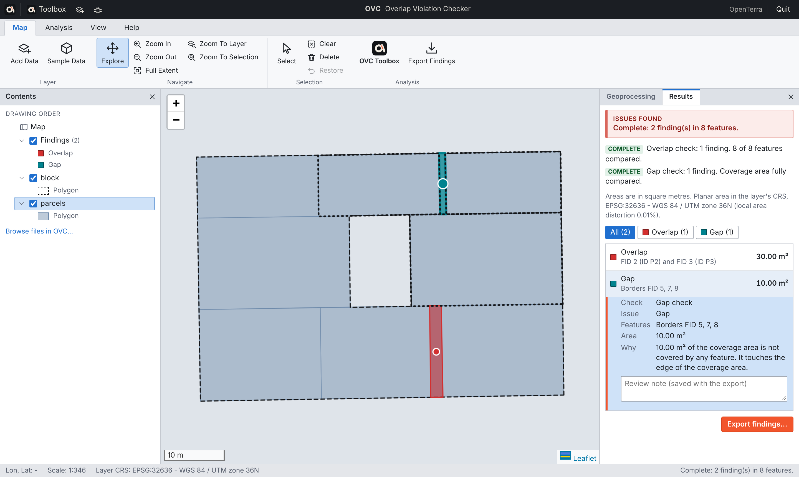
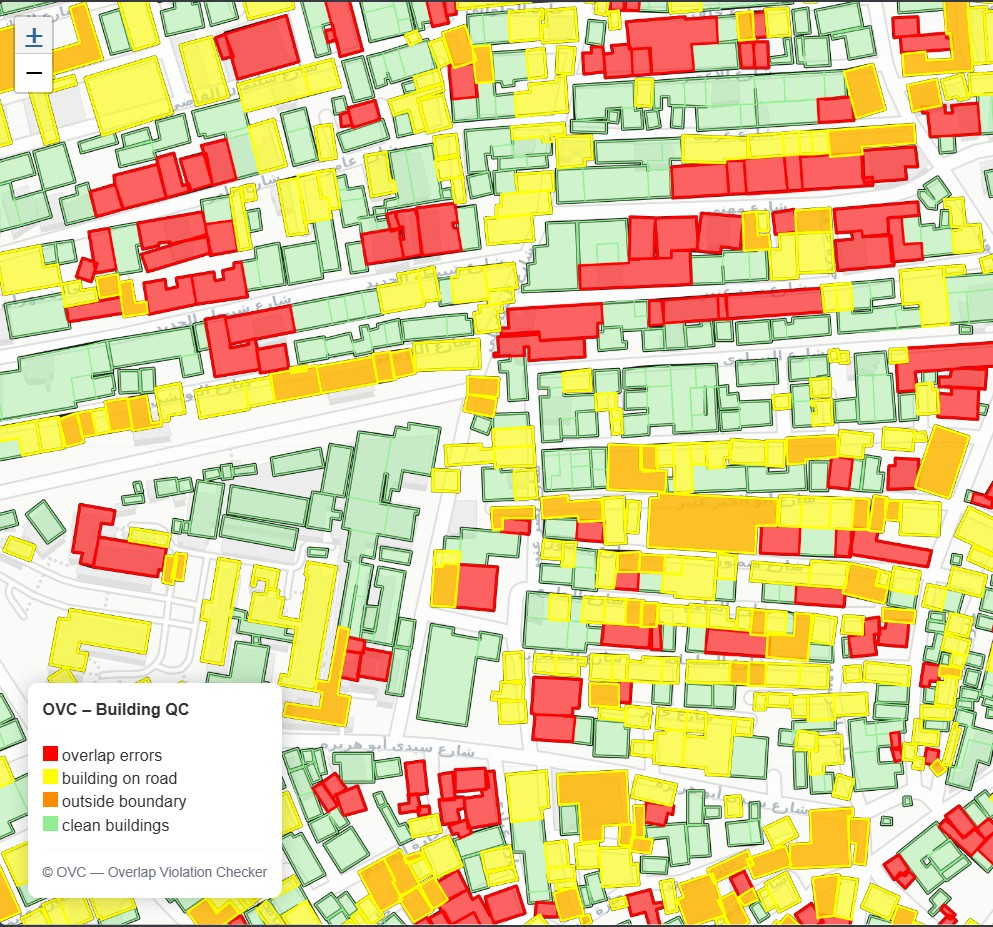

<p align="center">
  <picture>
    <source media="(prefers-color-scheme: dark)" srcset="assets/brand/logo-dark.svg">
    
  </picture>
</p>

<h1 align="center">OVC — Overlap Violation Checker</h1>

<p align="center">
  <strong>Find overlaps and gaps in polygon layers, on a map</strong><br>
  <em>Runs on your computer, offline. Also a building and road QC pipeline for the command line and Python.</em>
</p>

<p align="center">
  <a href="https://github.com/AmmarYasser455/ovc"></a>
  <a href="https://github.com/AmmarYasser455/ovc"></a>
  <a href="https://opensource.org/licenses/MIT"></a>
  <a href="https://github.com/AmmarYasser455/ovc/actions/workflows/ci.yml"></a>
</p>

---

## Check a layer from a map

Open OVC, choose a polygon layer, run the checks, click a finding to zoom to it, and save the findings as a GIS layer. No commands are needed.

<p align="center">
  
</p>

### Open OVC on Windows

1. Download `OVC-windows.zip` from the [latest release](https://github.com/AmmarYasser455/ovc/releases/latest). Until a release carries it, take the `OVC-windows` artifact from the newest [Windows app run](https://github.com/AmmarYasser455/ovc/actions/workflows/windows-app.yml).
2. Right-click the zip, choose **Extract All**, and open the `OVC` folder.
3. Double-click **OVC.exe**. OVC opens in your browser. It runs on your computer only and works offline. Windows may show a SmartScreen notice the first time because the app is not code-signed; choose **More info**, then **Run anyway**.

Python is not required. To stop OVC, press **Quit OVC** or close the tab.

### Review workflow

1. **Layer.** Press **Choose file…** and pick a GeoPackage, Shapefile, GeoJSON, FlatGeobuf, GML, KML or file geodatabase. If the file has several layers, pick one. OVC shows the layer name, feature count and CRS. Or press **Try the sample data**.
2. **Checks.** *Overlaps* needs nothing else. *Gaps* is off by default and needs a second polygon layer: the area that should be fully covered, such as a parcel block.
3. **Run checks.** The banner says whether the run is clean, found issues, is partial (features were skipped) or failed. A file that cannot be read is a failed run, never "0 issues".
4. **Review.** Click a finding in the list or on the map. OVC zooms to its geometry, outlines the source features and shows the check, the feature IDs, the area in m² and the reason. Filter the list by issue type.
5. **Export.** Save the findings as a GeoPackage in the layer's CRS, or as GeoJSON in WGS 84. Your input files are opened read-only.

### Try it on the sample

The app ships with [`ovc_sample.gpkg`](ovc/sample_data/ovc_sample.gpkg), a synthetic block in EPSG:32636 (metres). **Try the sample data** loads it. Expected results:

| Layer | Checks | Findings |
|---|---|---|
| `parcels`, coverage layer `block` | Overlaps + Gaps | Overlap P2/P3, **30 m²**. Gap beside P8, **10 m²**, touching the block edge. The pond (a hole in `block`) is not a gap. |
| `buildings` | Overlaps | Overlap B1/B2, **16 m²**. Duplicate B3/B4, **100 m²**. B6 inside B5, **9 m²**. The courtyard in B7 and the wall shared by B7 and B8 are not findings. |

[`examples/sample/make_sample.py`](examples/sample/make_sample.py) rebuilds the file.

## What the checks report

**Overlaps.** Every pair of distinct features whose intersection has area, reported once per pair with the full intersection (all parts). Features that only share an edge or a vertex do not overlap. Each finding has one of three issue types, and all three count as overlap findings:

| Issue type | Meaning |
|---|---|
| `overlap` | The features share part of their area. |
| `containment` | At least 98% of the smaller feature lies inside the other. |
| `duplicate` | The shared area is at least 98% of both features: identical or near-identical polygons. Three identical features give three duplicate pairs. |

**Gaps.** Each connected part of the coverage area that no feature covers, with its area and whether it touches the edge of the coverage area. Holes in the coverage polygons are not expected to be covered. OVC never derives the coverage area from a bounding box or hull; without a coverage layer the gap check does not run and the overlap check still does.

**Input quality.** Features that cannot be checked are listed, never dropped silently.

| Input | What OVC does |
|---|---|
| Layer has no CRS | The run fails with an explanation. In the app you can declare the EPSG code for that run; the file is not changed. |
| Invalid polygon (for example self-intersecting) | Reported with the reason and skipped. The run is partial and the gap check is marked incomplete, because the area that feature covers is unknown. With **Repair invalid geometries in memory** on, it is repaired for the run and checked. |
| Empty geometry, point or line | Reported and skipped; it covers no area. The run is partial. |
| Repeated or missing values in your ID field | Reported as a warning. Every finding also carries the FID stored in the file (QGIS `$id`). |
| A geometry operation fails | The affected pair is listed and the check is marked incomplete. |

**Areas and thresholds.** Areas are in square metres. If the layer's CRS is projected and distorts area by at most 1% over the layer (a UTM zone or national grid used where it is meant to be used), OVC measures planar area in that CRS and converts feet to metres, so the numbers match your GIS. If the layer is in degrees, or in a projection such as Web Mercator that distorts area more than that, OVC reprojects in memory to the WGS 84 / UTM zone at the layer's centre. The method used is shown with the results and stored in the export. Findings smaller than the limit (default 0.01 m² for overlaps and for gaps) are not reported; a finding whose area equals the limit is reported, and a limit of 0 reports everything with any area.

**Export.** The GeoPackage has an `ovc_findings` layer (MultiPolygon, in the source layer's CRS) with `issue_type`, `fid_a`, `fid_b`, `id_a`, `id_b`, `area_m2`, `overlap_ratio`, `related_fids` and `reason`, plus an `ovc_run_summary` table with the status, options, area method and skipped features.

## Building and road QC pipeline

OVC also runs a batch QC pipeline for building and road datasets from the command line:

- Building overlaps, classified as duplicate, contained, partial or sliver
- Boundary compliance and building-on-road conflicts
- Road network checks: disconnected segments, self-intersections, dangles
- Geometry quality: invalid geometry, area reasonableness, compactness, road setback
- GeoPackage, CSV and HTML web map outputs, with an optional [GeoQA](https://github.com/AmmarYasser455/geoqa) pre-check

<div align="center">

</div>

## Install with Python

```bash
git clone https://github.com/AmmarYasser455/ovc.git
cd ovc
pip install .
```

Python 3.10 or newer. Install from the repository; the name `ovc` on PyPI belongs to another project. This installs three ways in:

| Command | What it does |
|---|---|
| `ovc-gui` | Opens the map app (same as `OVC.exe`; no console window on Windows) |
| `ovc check FILE` | Overlap and gap check of one polygon layer |
| `ovc --buildings FILE ...` | Building and road QC pipeline |

All of them, and the Python API, use the same engine in [`ovc/engine`](ovc/engine).

## Command line

```bash
# Overlaps in one layer; exit code 0 clean, 1 issues, 2 partial, 3 failed
ovc check parcels.gpkg --layer parcels --id-field parcel_ref --out findings.gpkg

# Overlaps and gaps against a coverage layer
ovc check parcels.gpkg --layer parcels --gaps --coverage parcels.gpkg --coverage-layer block

# Building QC pipeline (also: python scripts/run_qc.py ...)
ovc --buildings buildings.shp --out outputs
ovc --buildings buildings.shp --roads roads.shp --boundary boundary.shp --out outputs
ovc --buildings buildings.shp --roads roads.shp --road-qc --precheck --out outputs
```

`ovc check --help` and `ovc --help` list every option.

## Python API

```python
import ovc

result = ovc.check_file(
    "parcels.gpkg", "parcels",
    check_gaps=True, coverage_path="parcels.gpkg", coverage_layer="block",
)
print(result.status, result.counts_by_type())   # issues {'overlap': 1, 'gap': 1}
ovc.export_findings(result, "findings.gpkg")

# On a GeoDataFrame you already have
result = ovc.check_polygons(gdf, min_overlap_area_m2=0.5)

# Building QC pipeline
from pathlib import Path
outputs = ovc.run_pipeline(buildings_path=Path("buildings.shp"), out_dir=Path("outputs"))
```

The geometry quality functions (`find_duplicate_geometries`, `find_invalid_geometries`, `find_unreasonable_areas`, `compute_compactness`, `find_min_road_distance_violations`) are documented in the [API reference](docs/api-reference.md).

## GeoQA Integration

OVC integrates with [**GeoQA**](https://github.com/AmmarYasser455/geoqa) — a Python package for geospatial data quality assessment — as a **data-readiness gate** before running the QC pipeline.

When you pass `--precheck`, OVC uses GeoQA to:

1. **Profile** each input dataset (buildings, roads, boundary)
2. **Compute** a quality score (0–100) based on geometry validity, attribute completeness, and CRS
3. **Detect** invalid, empty, duplicate, and null geometries
4. **Run** topology checks (slivers, bad rings, overlaps)
5. **Classify** issues as **warnings** (proceed with caution) or **blockers** (stop — fix data first)
6. **Generate** HTML quality reports for each dataset

If a dataset has blockers, OVC logs a warning and continues, so check the pre-check summary and reports before trusting the results. GeoQA is installed with OVC; there's no separate install step.

**Try it in 5 minutes:** the [GeoQA → OVC walkthrough](examples/geoqa-to-ovc/README.md) runs both tools on a tiny dataset with a planted overlap and a building on a road. It shows what GeoQA reports, what OVC adds, and where each result lands.

| Workflow Step | Tool | What It Does |
|---|---|---|
| **Data Readiness** | GeoQA | Profile, validate, and score input datasets |
| **Building QC** | OVC | Overlap, boundary, and road conflict detection |
| **Road QC** | OVC | Disconnected segments, self-intersections, dangles |

## Quality Checks

### Building QC

| Check | Description |
|---|---|
| Overlap Detection | Duplicate, contained, partial and sliver overlaps (shared engine) |
| Boundary Compliance | Buildings touching or outside administrative boundary |
| Road Conflict | Buildings conflicting with road geometries |
| Duplicate Geometry | Identical building footprints (WKB comparison) |
| Invalid Geometry | Self-intersections, topology errors |
| Area Reasonableness | Unreasonably small or large buildings |
| Compactness Score | Polsby-Popper shape regularity check |
| Road Setback | Buildings too close to roads |

### Road QC

| Check | Description |
|---|---|
| Disconnected Segments | Roads not connected to the network |
| Self-Intersections | Roads that cross themselves |
| Dangles | Dead-end endpoints (incomplete digitization) |

## Pipeline outputs

```
outputs/
├── precheck/                      # GeoQA quality reports (when --precheck)
│   ├── buildings_quality_report.html
│   ├── roads_quality_report.html
│   └── boundary_quality_report.html
├── building_qc/
│   ├── building_qc.gpkg          # GeoPackage with issue layers
│   ├── building_qc_map.html      # Interactive web map
│   └── building_qc_metrics.csv   # Summary metrics
└── road_qc/                      # When --road-qc is enabled
    ├── road_qc.gpkg
    ├── road_qc_map.html
    └── road_qc_metrics.csv
```

| Output Type | Description |
|---|---|
| **GeoPackage** | Spatial layers containing detected issues |
| **CSV reports** | Summary statistics and metrics |
| **HTML web map** | Interactive map for visual inspection |
| **HTML quality report** | GeoQA pre-check assessment (when enabled) |

## Pipeline configuration

Pipeline thresholds are set in `ovc/core/config.py`:

| Parameter | Default | Description |
|---|---|---|
| `duplicate_ratio_min` | 0.98 | Covered share of both buildings for `duplicate`, of the smaller one for `contained` |
| `partial_ratio_min` | 0.30 | Covered share of the smaller building for `partial`; below it the overlap is a `sliver` |
| `min_intersection_area_m2` | 0.5 | Smallest overlap reported (an equal area is reported) |
| `road_buffer_m` | 1.0 | Buffer distance around roads |

## Repository layout

```
ovc/
├── engine/       # Topology engine: overlaps, gaps, input quality, area measurement (no I/O)
├── io/           # Read layers with their FIDs; export findings
├── api.py        # check_file(): read a layer and run the engine
├── app/          # Map app: local server, launcher, browser UI (static/)
├── cli.py        # ovc command
├── sample_data/  # Sample GeoPackage bundled with the app
├── checks/ loaders/ export/ metrics/ core/   # Building QC pipeline
├── precheck/     # GeoQA pre-check
└── road_qc/      # Road network QC
packaging/windows/  # OVC.exe build
examples/           # Sample generator, GeoQA -> OVC walkthrough
tests/              # Engine fixtures, I/O, server, CLI and browser workflow tests
```

Design notes are in [ARCHITECTURE.md](ARCHITECTURE.md).

## Supported Formats

All vector formats readable by GeoPandas/Fiona: Shapefile, GeoJSON, GeoPackage, KML, GML, File Geodatabase, and more via GDAL/OGR drivers.

## Troubleshooting

| Issue | Cause | Fix |
|---|---|---|
| "The layer has no CRS" | Shapefile without a `.prj`, or a file exported without CRS | Define the CRS in your GIS, or declare the EPSG code in the app for that run |
| Partial run | Invalid, empty or non-polygon features were skipped | Open **skipped features** in the results; fix them or turn on in-memory repair |
| The map draws no features | The layer has more than 20,000 features | All features are still checked; the features behind a finding are drawn when you select it |
| OVC did not open | Start-up error | See `.ovc\ovc-app.log` in your user folder |

## Development

```bash
pip install -e ".[dev]"
pytest                                   # engine, I/O, server, CLI
pip install playwright && python -m playwright install chromium
pytest tests/test_gui_workflow.py        # the click-through workflow in a browser
pre-commit run --all-files
```

## Contributing

Contributions are welcome. See [CONTRIBUTING.md](CONTRIBUTING.md).

## Author

**Ammar Yasser**

- GitHub: [@AmmarYasser455](https://github.com/AmmarYasser455)
- LinkedIn: [Ammar Yasser](https://www.linkedin.com/in/ammar-yasser522)

## License

[MIT License](LICENSE)

## Acknowledgments

OVC works alongside [GeoQA](https://github.com/AmmarYasser455/geoqa). It is built on [GeoPandas](https://geopandas.org/), [Shapely](https://shapely.readthedocs.io/), [pyogrio](https://pyogrio.readthedocs.io/) and [Folium](https://python-visualization.github.io/folium/). The map app bundles [Leaflet](https://leafletjs.com/) (BSD 2-Clause, [license](ovc/app/static/vendor/leaflet/LICENSE)).

## Citation

```bibtex
@software{ovc2026,
  title   = {OVC: Overlap Violation Checker for Geospatial Data},
  author  = {Ammar Yasser Abdalazim},
  year    = {2026},
  url     = {https://github.com/AmmarYasser455/ovc},
  license = {MIT}
}
```
