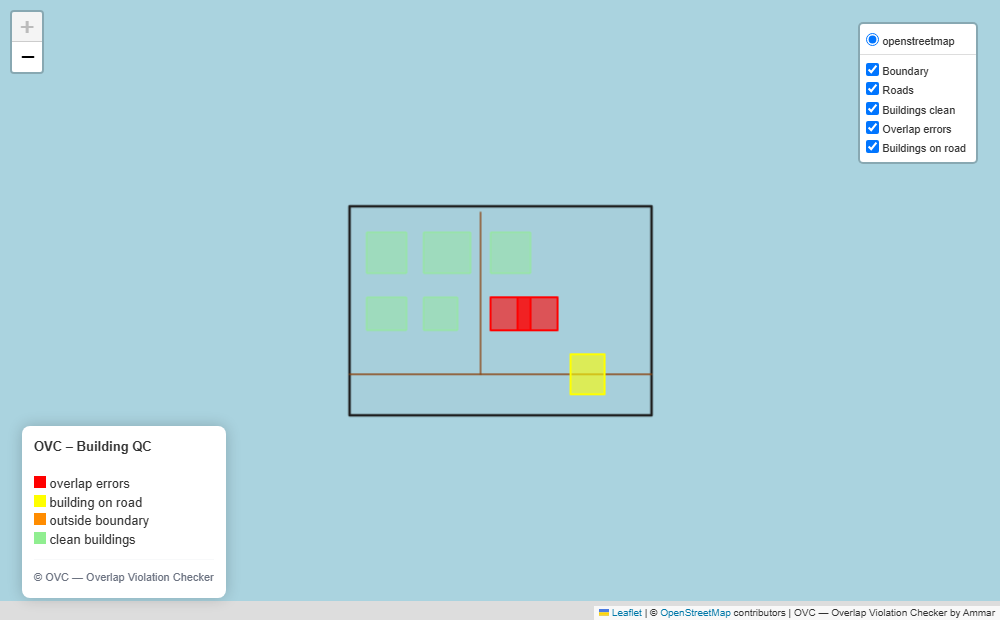

# From GeoQA to OVC: a 5-minute walkthrough

Profile a building layer with [GeoQA](https://github.com/AmmarYasser455/geoqa), then let OVC check buildings against each other, the roads and the study area. You run everything on a tiny generated dataset, so you can see exactly what each tool reports.

| Step | Tool | Answers |
|---|---|---|
| 1. Profile | GeoQA | Is the layer usable at all? CRS, valid and empty geometries, duplicates, attribute completeness, score |
| 2. Check | OVC | Which buildings conflict, and how? Overlaps (classified), buildings on roads, buildings at or outside the boundary |

## The data

`make_data.py` writes three small GeoJSON files (EPSG:4326, public domain). The layout is synthetic and placed at "Null Island" (0°, 0°), so it can't be mistaken for real buildings.

| File | Features | Planted problems |
|---|---|---|
| `buildings.geojson` | 8 buildings, B1–B8 | **B5 and B6 overlap** (a 4 m × 10 m strip); **B8 is drawn across the main road** |
| `roads.geojson` | 2 road centrelines | |
| `boundary.geojson` | the study area | |

The three files are committed, so you can skip regenerating them.

## Run it

From the root of an OVC checkout:

```bash
pip install -e .                 # installs OVC and GeoQA. Don't use "pip install ovc": that PyPI name belongs to another project.
cd examples/geoqa-to-ovc
python make_data.py              # optional: rebuilds the three GeoJSON files
```

> **Windows:** GeoQA 0.2.0 prints emoji that the default Windows console can't encode, so its commands stop with `UnicodeEncodeError`. Run `set PYTHONUTF8=1` (cmd) or `$env:PYTHONUTF8=1` (PowerShell) once first.

### 1. Profile the buildings with GeoQA

```bash
geoqa check buildings.geojson
```

```
  ✅ Geometry Validity: All geometries valid
  ✅ Empty Geometries: No empty geometries
  ✅ Duplicate Geometries: No duplicate geometries
  ✅ CRS Defined: CRS: EPSG:4326
  ✅ Attribute Completeness: 0 null values (0.0% of all cells)
  ✅ Homogeneous Geometry Types: Single geometry type

  📊 Quality Score: 100.0/100
```

The layer is technically sound. Topology is only in the HTML report:

```bash
geoqa report buildings.geojson --output outputs/geoqa/buildings_report.html
```

Open the report and look at **Topology Checks**. It says *Self-Overlapping Polygons: 1 pairs of polygons overlap*, but not which buildings, how much, or anything about the roads. The quality score stays 100/100.

### 2. Check buildings and roads with OVC

```bash
python ../../scripts/run_qc.py --buildings buildings.geojson --roads roads.geojson --boundary boundary.geojson --precheck --out outputs/ovc
```

`--precheck` runs GeoQA on each input first and prints a summary (all three are `READY`, score 100). It writes one report per input to `outputs/ovc/precheck/`. If an input has blockers, OVC logs a warning and continues. Then OVC reports:

```
[INFO] Found 1 overlaps
[INFO] Found 1 building-road conflicts
[INFO] GeoPackage: outputs/ovc/building_qc/building_qc.gpkg
[INFO] Metrics CSV: outputs/ovc/building_qc/building_qc_metrics.csv
[INFO] Web map: outputs/ovc/building_qc/building_qc_map.html
```

## What OVC adds

| Question | GeoQA | OVC |
|---|---|---|
| Do any buildings overlap? | "1 pairs of polygons overlap" | **B5 and B6**, a **partial** overlap of **40.1 m²** |
| Is any building on a road? | can't tell (it profiles one layer) | **B8** (`building_on_road`) |
| Which buildings are clean? | – | **5** buildings, in their own layer |

Where to find each result:

| File | What's inside |
|---|---|
| `outputs/ovc/building_qc/building_qc_map.html` | Open it in a browser: red = overlap, yellow = building on road, green = clean |
| `outputs/ovc/building_qc/building_qc.gpkg` | Layers `errors` (3 rows), `buildings_clean` (5), `roads`, `boundary`. Open it in QGIS or ArcGIS Pro to fix the buildings |
| `outputs/ovc/building_qc/building_qc_metrics.csv` | `overlap_count 1`, `overlap_partial_count 1`, `overlap_total_area_m2 40.1`, `count_building_on_road 1` |
| `outputs/geoqa/buildings_report.html`, `outputs/ovc/precheck/*.html` | GeoQA quality reports |

In the `errors` layer, `bldg_id` is the 0-based row of `buildings.geojson`: rows 4 and 5 are B5 and B6, and row 7 is B8.



## Python, or the ArcGIS Pro toolbox?

* **This Python package** suits scripts, notebooks, batch runs and CI: files in, GeoPackage, CSV and web map out, no GIS licence.
* **[OVC ArcGIS Pro](https://github.com/AmmarYasser455/ovc-arcgis-pro)** suits work that's already inside ArcGIS Pro. It has five geoprocessing tools: building overlaps, building–road conflicts, road dangles, disconnected roads and road self-intersections. They write feature classes into your project, and each runs the GeoQA pre-check when `geoqa` is installed in ArcGIS Pro's Python. The boundary checks exist only in the Python package.

This walkthrough is tested in CI: `tests/test_geoqa_to_ovc_example.py` runs OVC on these files and checks the numbers above.
