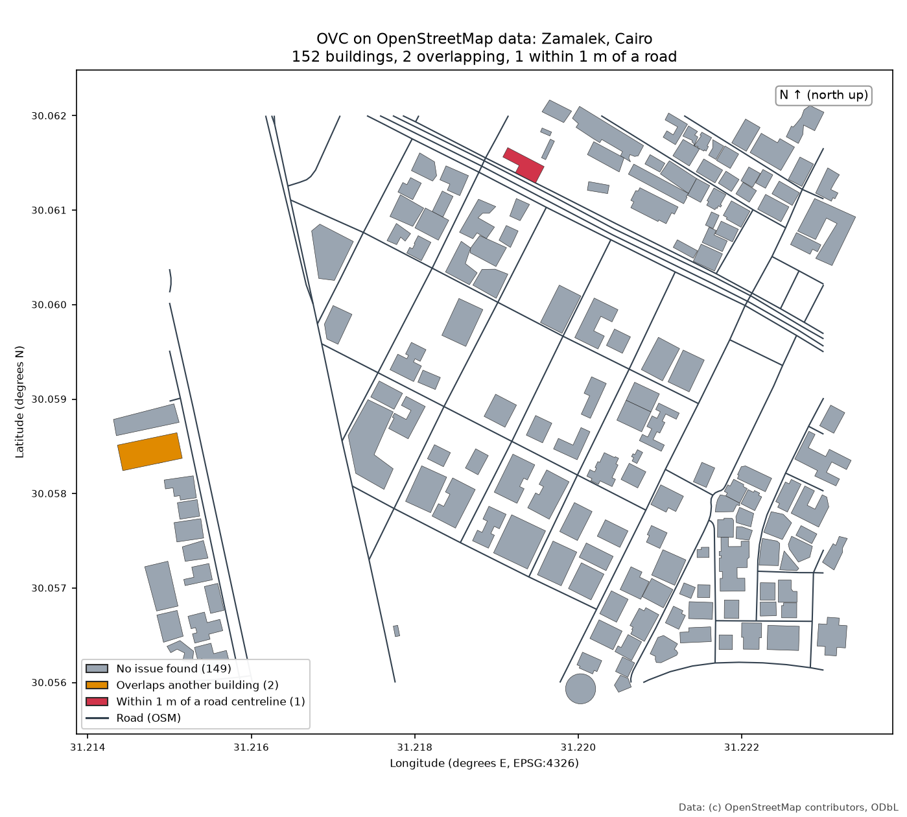

# OVC on OpenStreetMap data: Zamalek, Cairo

## Question

In a small part of Zamalek (Cairo, Egypt), which OpenStreetMap building footprints overlap another footprint, and which sit within 1 m of a road centreline?

## Data

Real data only, saved in [`data/`](data/) (about 66 KB in total):

| File | Content | Source | License |
|---|---|---|---|
| `data/buildings.geojson` | 152 closed OSM ways tagged `building=*` | OpenStreetMap via the Overpass API, https://overpass-api.de/api/interpreter | ODbL 1.0, (c) OpenStreetMap contributors, https://www.openstreetmap.org/copyright |
| `data/roads.geojson` | 56 OSM `highway=*` ways (footways, paths, steps, cycleways, service roads, pedestrian ways and corridors excluded), clipped to the query box | same | same |

- Query box (south, west, north, east): `30.0560, 31.2150, 30.0620, 31.2230` (EPSG:4326).
- Date fetched: 2026-11-17 (OSM database snapshot `2026-11-17T10:02:05Z`).
- Buildings were requested with `way["building"](bbox)`, roads with `way["highway"]["highway"!~"footway|path|steps|cycleway|service|pedestrian|corridor"](bbox)`, both with `out geom`. Ways were converted to GeoJSON polygons and lines with attributes `osmid`, `building` or `highway`, and `name`. Building ways were kept whole (a few extend past the box); road ways were cut at the box edge. Nothing else was edited.

## Method

`python showcase/make_showcase.py` runs this repository's own code on `data/`:

1. `ovc.loaders.buildings.load_buildings` and `ovc.loaders.roads.load_roads` read the files (EPSG:4326, lon/lat).
2. `ovc.core.crs.get_crs_pair` picks the local UTM zone for the data: EPSG:32636 (UTM 36N). Areas and distances are computed in metres in that CRS, not in degrees.
3. `ovc.checks.overlap.find_building_overlaps` with the default thresholds (`DEFAULT_CONFIG.overlap`: intersection at least 0.5 m2; ratio of intersection to the smaller footprint at least 0.98 is `duplicate`, at least 0.30 `partial`, otherwise `sliver`).
4. `ovc.checks.road_conflict.find_buildings_on_roads` with the default 1.0 m buffer around road centrelines and a 0.5 m2 minimum intersection.
5. Results are written back to EPSG:4326 (RFC 7946, lon/lat) in `map.geojson`.

## Results

From the real output:

- 152 buildings and 56 road features were checked.
- 1 overlapping pair, classified `duplicate`. OSM way 776419800 (tagged "British Council", 2194 m2) contains way 448046963 (631 m2); the intersection is 631.4 m2, i.e. the whole smaller footprint. The 631 m2 part may be a deliberately mapped part of the larger building rather than a mistake, so this is a candidate for review, not a confirmed error.
- 1 building within 1 m of a road centreline: way 39411085 (852.8 m2, tagged with an Arabic name meaning a hotel for armed-forces officers) intersects the 1 m buffer of way 174550361 (a tertiary road named 26 July Street) over 19.3 m2.
- 149 of 152 buildings (98%) had no finding at these thresholds. The 1 m buffer is narrow: real road widths are larger, so this counts only footprints that touch the centreline's immediate surroundings.

## Map



- Web map: [index.html](index.html) (Leaflet with OpenStreetMap tiles; popups show the properties). Browsers block `fetch` on `file://`, so serve the folder, for example `python -m http.server` and open `/showcase/index.html`.
- Notebook: [showcase.ipynb](showcase.ipynb) (same steps with the Python API; outputs saved)
- GeoJSON: [map.geojson](map.geojson) (EPSG:4326; each building has `status`, `area_m2`, `overlap_type`, `overlap_area_m2`, `road_conflict_area_m2`; roads have `highway` and `name`)

## Rebuild

```bash
python showcase/make_showcase.py
```

It runs offline from `showcase/data/` and rewrites `map.geojson`, `map.png` and `index.html`. `tests/test_showcase.py` checks that a fresh build equals the committed `map.geojson`. The notebook is executed with `python -m jupyter nbconvert --to notebook --execute --inplace showcase/showcase.ipynb`.

Map data (c) OpenStreetMap contributors, ODbL.
